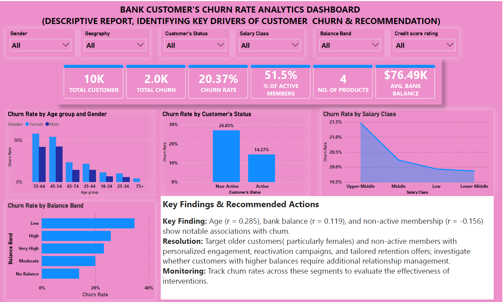

# bank-customer-churn-analysis
Bank customer churn analysis and retention recommendations using Power BI.

# Bank Customer Churn Analysis | Power BI

## Project Overview

Customer churn is a significant challenge for banks because losing customers can affect customer lifetime value, revenue opportunities, and long-term business relationships.

This project analyzes customer data to explore the relationship between customer characteristics, account information, membership status, and customer churn. Using Power BI, the analysis identifies potential churn indicators and translates the findings into actionable customer retention recommendations.

The objective is to help decision-makers better understand customer churn patterns, identify potentially vulnerable customer segments, and develop data-driven retention strategies.

## Business Problem

The bank needs to understand which customer characteristics are associated with churn and how customer data can support more effective retention decisions.

Key business questions include:

* Which customer age groups show higher churn tendencies?
* Is bank balance associated with customer churn?
* How does membership status relate to customer retention?
* What roles do tenure, number of products, credit card ownership, and salary grade play in churn patterns?
* How can the bank use these insights to improve customer engagement and retention?

## Project Objectives

* Analyze customer churn patterns using Power BI.
* Examine relationships between customer attributes and churn.
* Identify potential risk indicators and customer segments for further investigation.
* Develop practical recommendations for improving customer retention.
* Present findings through an interactive dashboard for business decision-making.

## Dataset and Key Variables

The analysis considers the following customer attributes:

| Variable           | Description                                                                                           |
| ------------------ | ----------------------------------------------------------------------------------------------------- |
| Age                | Customer age                                                                                          |
| Tenure             | Length of the customer relationship                                                                   |
| Bank Balance       | Customer account balance                                                                              |
| Number of Products | Number of banking products held                                                                       |
| Credit Card        | Credit card ownership status                                                                          |
| Member Status      | Whether the customer is an active member                                                              |
| Salary Grade       | Customer salary or estimated income category                                                          |
| Churn              | Whether the customer has exited or discontinued the relationship, according to the dataset definition |

## Tools and Techniques

* **Power BI:** Data visualization, dashboard development, and exploratory analysis.
* **Power Query:** Data cleaning and transformation, where applied.
* **DAX:** Measures and calculated metrics, where applied.
* **Correlation Analysis:** Exploring the direction and strength of relationships between selected variables and churn.
* **Customer Segmentation:** Comparing customer groups to identify potential retention priorities.

## Key Findings

The preliminary correlation analysis identified the following relationships with churn While all other customer attribute shows a weak correlation with Churn:

| Variable      | Correlation (r) | Interpretation                       |
| ------------- | --------------: | ------------------------------------ |
| Age           |          +0.285 | Positive association with churn      |
| Member Status |          -0.156 | Negative association with churn      |
| Bank Balance  |          +0.119 | Weak positive association with churn |

**Age** showed the strongest correlation among these three variables. Membership status and bank balance showed weaker relationships.

These results are exploratory indicators, not proof that any variable causes customer churn. 

Other variables, including tenure, number of products, credit card ownership, and salary grade shows weaker correlation with Churn.

## Key Findings and Recommended Actions

### 1. Customer Age

**Finding:** Age had a positive correlation with churn (r = 0.285), indicating that older customers largely females were associated with higher churn in the analyzed data.

**Recommendation:** investigate the needs, service preferences, and engagement patterns of Older customers and  consider a tailored engagement and retention campaigns for that age group.

### 2. Membership Status

**Finding:** Member status had a negative correlation with churn (r = -0.156) indicating that inactive customers are associated with higher churn.

**Recommendation:** Introduce a targeted reactivation campaigns, personalized communication, and relevant retention offers.

### 3. Bank Balance

**Finding:** Bank balance had a positive correlation with churn (r = 0.119), indicating that customers with higher bank balance are associated with higher churn although the relationship was relatively weak.

**Recommendation:**  Determine whether higher-balance customers experience service gaps or relationship-management issues before introducing enhanced relationship management or retention initiatives.

## Conclusion

This project demonstrates how customer data can be explored and visualized to identify potential churn indicators and support customer retention decisions.

## Dashboard

## Project Deliverables

* Interactive Power BI dashboard.
* Customer churn analysis report.
* Key findings and business recommendations.
* Dashboard screenshots and supporting documentation.

**Author:** Samuel Shobowale

**Area of Interest:** Data Analytics | Business Intelligence | Power BI

